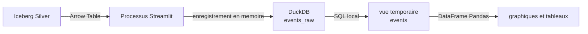

# DuckDB

## Role

DuckDB est un moteur SQL analytique embarque dans le processus Streamlit. Il
sert aux requetes interactives rapides du dashboard : metriques, listes de
sessions, regroupements par modele et outils utilises.

Il ne dispose pas de conteneur Docker propre et ne persiste aucune table dans ce
projet. Une nouvelle connexion DuckDB est creee pour une execution du dashboard.

## Entrees et sorties



Le dashboard charge un index Iceberg sous forme de table Arrow. DuckDB enregistre
cette table en memoire, cree une vue temporaire `events`, puis supprime les
doublons par `session_id` et `event_id`.

```text
Iceberg / Arrow Table
  -> DuckDB events_raw
  -> vue temporaire events
  -> DataFrame Pandas
  -> graphiques et tableaux Streamlit
```

DuckDB retourne des DataFrames a Streamlit avec `fetchdf()`. Les requetes ne
modifient pas Iceberg, S3 ou les tables Gold.

## Pourquoi DuckDB et Spark

DuckDB est utilise lorsque les donnees necessaires sont deja chargees par le
snapshot Iceberg dans le stockage, pour les calculs batch ou les requetes SQL
plus lourdes. Les deux utilisent Iceberg comme source de verite analytique.
