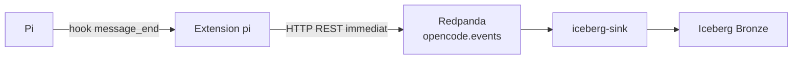

# Pi et export

## Role

Pi est la source des conversations et traces visibles. L'extension
`pi/extensions/observatory-export.ts` utilise l'evenement `message_end` pour
publier chaque message finalise directement vers Redpanda.

## Flux direct



L'extension ignore les blocs `thinking` et les messages systeme. Elle publie
les prompts, reponses visibles, appels d'outils et resultats d'outils. Une
erreur Redpanda ne bloque pas la conversation pi.

| Etape | Recoit | Produit |
| --- | --- | --- |
| hook `message_end` | message pi finalise | evenements visibles |
| `observatory-export.ts` | evenement pi | enregistrement REST Redpanda |
| `iceberg-sink` | topic Redpanda | table Bronze Iceberg |

## Test

Lancer pi depuis la racine du depot :

```bash
pi
```

L'extension projet `.pi/extensions/observatory-export.ts` est alors chargee.
Le script `scripts/pi-export-to-events.py` reste disponible pour rejouer ou
importer un ancien fichier JSONL, mais il ne sert pas au flux normal.
