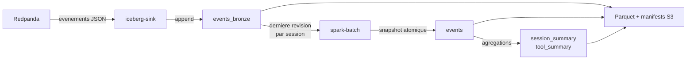

# Apache Iceberg

## Role

Iceberg transforme des fichiers Parquet S3 en tables analytiques versionnees.
Chaque commit publie un snapshot coherent : les lecteurs voient soit l'ancien
snapshot, soit le nouveau, jamais une ecriture partielle.

Les tables du projet sont :

- `opencode.events` : evenements actifs, couche Silver.
- `opencode.events_bronze` : journal append-only des evenements Redpanda.
- `opencode.session_summary` : agregats de sessions, couche Gold.
- `opencode.tool_summary` : agregats d'outils, couche Gold.

## Lancement

Le service `iceberg` execute le catalogue REST sur `http://localhost:8181` :

```bash
docker compose up -d iceberg
```

Le catalogue stocke ses donnees relationnelles dans SQLite et les references des
snapshots pointent vers les objets S3 du warehouse `s3://bigdata/iceberg/`.

## Ce qu'Iceberg recoit et produit



Le consommateur Redpanda transforme chaque lot en table Arrow et committe Bronze.
Spark lit les metadonnees du catalogue, planifie un snapshot, puis promeut la
derniere version de chaque session vers Silver et ecrit les tables Gold.

Les fichiers Iceberg sont des Parquet de donnees, des manifests Avro et des
fichiers de metadonnees JSON. Leur gestion est interne : les consommateurs
utilisent les noms de tables, pas les chemins S3.

## ACID et limites

Iceberg apporte l'atomicite, l'isolation par snapshot, le controle de schema et
la durabilite des commits. La transaction porte sur une table. Le commit de
`opencode.events` et les commits des tables Gold sont donc independants.

Lire [Gouvernance et garanties ACID](../guide/data-governance.md) et
[ADR 0001](../decisions/0001-iceberg-transaction-boundary.md) pour les details.
