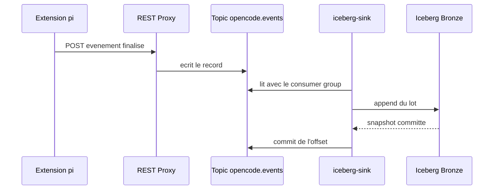

# Redpanda

## Role

Redpanda est le journal d'evenements entre l'extension pi et Iceberg. Elle
recoit chaque evenement visible dans le topic `opencode.events`, conserve les
enregistrements et permet au consommateur de reprendre depuis son offset.

Le nom historique du topic est conserve pour ne pas casser les tables et les
lecteurs existants.

## Endpoints

| Interface | Adresse hote | Usage |
| --- | --- | --- |
| Kafka | `localhost:19092` | consommateur et outils Kafka |
| REST Proxy | `http://localhost:18082` | publication JSON par l'extension |

Le broker local est unique et le topic utilise une partition. Cette
configuration est adaptee a une demonstration locale, pas a une production
hautement disponible.

## Ingestion Iceberg



`iceberg-sink` est en at-least-once : une interruption peut rejouer un lot.
Spark deduplique ensuite les revisions Bronze par session et `event_id` lors
de la promotion Silver.

## Observation

```bash
docker compose logs -f redpanda iceberg-sink
docker compose exec redpanda rpk topic describe opencode.events -X brokers=localhost:9092
```
