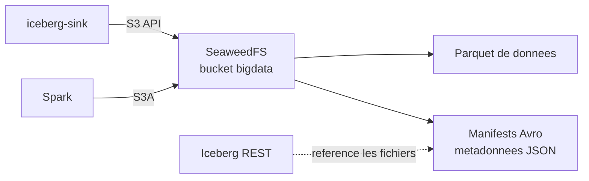

# SeaweedFS et S3

## Role

Le service `s3` execute SeaweedFS. Il fournit une API compatible S3 locale pour
stocker les fichiers de donnees Iceberg et leurs metadonnees.
Il remplace AWS S3 dans ce projet de cours.

## Lancement

SeaweedFS demarre avec Docker Compose :

```bash
docker compose up -d s3
```

Son API est exposee localement sur `http://localhost:8333`. Le bucket utilise
est `bigdata`. Les identifiants de demonstration sont `admin` et
`bigdata-local-secret`.

## Ce qu'il recoit et conserve



| Prefixe S3 | Contenu | Producteur |
| --- | --- | --- |
| `iceberg/opencode/` | Parquet, manifests et metadonnees Iceberg | sink et Spark |

SeaweedFS ne comprend pas le contenu analytique des fichiers : il stocke des
objets. Iceberg est la brique qui donne un sens transactionnel a ces objets.

## Persistance et observation

Le volume Docker `esn81-big-data_s3-data` conserve les objets hors du cycle de
vie du conteneur. Pour lister les fichiers :

```bash
curl --fail-with-body --aws-sigv4 "aws:amz:us-east-1:s3" \
  --user "admin:bigdata-local-secret" \
  "http://localhost:8333/bigdata/?list-type=2&prefix=iceberg/opencode/"
```
