# Architecture generale

## Objectif

Conversation Observatory transporte et conserve les traces visibles des
sessions Pi et OpenCode, propose une consultation en streaming et historique,
et permet des traitements analytiques avec Spark. Le projet separe volontairement les donnees brutes, les tables
transactionnelles et les syntheses analytiques.

## Carte du systeme

```mermaid
flowchart LR
  PI["Pi"] -->|"hook message_end"| EX["Extension Pi"]
  OC["OpenCode"] -->|"plugin session.idle"| EX2["Plugin OpenCode"]
  EX -->|"HTTP REST immédiat<br/>JSON visible"| RP["Redpanda<br/>topic opencode.events"]
  EX2 -->|"HTTP REST immédiat<br/>JSON visible"| RP
  RP -->|"Kafka consumer<br/>offsets"| SINK["iceberg-sink"]
  RP -->|"Kafka source<br/>événements assistant"| ARROYO["Arroyo<br/>pipeline SQL"]
  ARROYO -->|"SSE natif<br/>EventSource"| LIVE["Dashboard HTML<br/>temps réel :8503"]
  SINK -->|"PyIceberg<br/>commit snapshot"| BRONZE["Iceberg Bronze<br/>events_bronze"]
  BRONZE -->|"Spark batch"| SILVER["Iceberg Silver<br/>events"]
  SILVER -->|"Spark batch"| GOLD["Iceberg Gold<br/>summaries"]
  BRONZE -->|"Arrow / PyIceberg<br/>aperçu temps réel"| DASH["Dashboard<br/>Streamlit + DuckDB"]
  DASH -->|"HTTP JSON SQL"| QUERY["spark-query"]
  QUERY -->|"Iceberg scan"| SILVER
  SINK -->|"S3 API<br/>Parquet + manifests"| S3["SeaweedFS / S3"]
  SILVER -->|"S3 API"| S3
  GOLD -->|"S3 API"| S3
```



Les fleches indiquent le protocole ou le format echange. Redpanda transporte les
evenements, Iceberg rend les donnees transactionnelles et S3 conserve les
fichiers physiques des tables.

```text
Pi
  -> extension `message_end`
  -> événements JSON visibles
  -> API REST Redpanda, topic opencode.events
  -> consommateur Kafka -> table Iceberg Bronze
  -> Spark -> table Iceberg Silver transactionnelle

Dashboard HTML temps réel
  -> Arroyo consomme directement opencode.events
  -> filtre SQL des réponses assistant visibles
  -> PreviewSink exposé en SSE
  -> EventSource met à jour le DOM sans recharger la page
  -> navigateur :8503

Dashboard Streamlit
  -> PyIceberg lit le journal Bronze
  -> DuckDB déduplique et execute les analyses interactives
  -> navigateur :8501

Spark SQL et batch
  -> catalogue Iceberg REST
  -> lit le snapshot opencode.events
  -> cree les tables Gold de synthese
```

Le detail du parcours d'une donnee est decrit dans
[Flux de donnees](data-flow.md). Les formats echanges entre les briques sont
decrits dans [Formats et transformations](../data/formats.md).

## Services Docker

| Service | Role | Port hote |
| --- | --- | --- |
| `s3` | SeaweedFS, stockage objet compatible S3 | 8333 |
| `iceberg` | catalogue REST Apache Iceberg | 8181 |
| `redpanda` | journal d'evenements Kafka et API REST | 19092, 18082 |
| `iceberg-sink` | consommateur Redpanda vers Iceberg Bronze | 8504 (SSE historique) |
| `arroyo` | moteur de streaming SQL et sortie SSE | 8510 |
| `arroyo-init` | provisionnement idempotent du pipeline Arroyo | aucun |
| `live-dashboard` | interface HTML alimentée directement par SSE | 8503 |
| `dashboard` | interface Streamlit | 8501 |
| `spark-query` | service Spark SQL interne | aucun |
| `spark-batch` | job Spark ponctuel, profil `spark` | aucun |
| `documentation` | site Docsify servi par Nginx | 8502 |

## Couches de donnees

- Bronze : table Iceberg append-only `opencode.events_bronze`, alimentee par le
  topic Redpanda. Elle conserve les revisions publiees des sessions.
- Silver : table Iceberg `opencode.events`. C'est la source de verite pour Spark
  SQL et les traitements analytiques. Le dashboard lit Bronze pour afficher les
  derniers événements immédiatement, puis déduplique localement.
- Gold : tables Iceberg `opencode.session_summary` et
  `opencode.tool_summary`, construites par Spark batch.

Les garanties ACID s'appliquent a chaque table Iceberg, y compris Bronze. Il
n'existe pas de transaction globale entre Redpanda et les tables Bronze, Silver
et Gold. Consulter [Gouvernance et garanties ACID](data-governance.md) pour le
detail.

## Role de chaque brique

| Brique | Responsabilite principale | Documentation detaillee |
| --- | --- | --- |
| Pi et export | produit, nettoie et publie les sessions | [Export](../components/export.md) |
| Redpanda | journalise les evenements et decouple producteurs/consommateurs | [Redpanda](../components/redpanda.md) |
| Arroyo | filtre le flux Kafka et diffuse les résultats en SSE | [Arroyo](../components/arroyo.md) |
| SeaweedFS/S3 | conserve durablement les objets | [S3](../components/seaweedfs-s3.md) |
| Iceberg | publie des snapshots transactionnels | [Iceberg](../components/iceberg.md) |
| Spark | execute SQL et calculs batch | [Spark](../components/spark.md) |
| DuckDB | analyse les donnees en memoire du dashboard | [DuckDB](../components/duckdb.md) |
| Streamlit | presente les donnees dans le navigateur | [Streamlit](../components/streamlit.md) |

## Regle d'architecture

Les consommateurs analytiques lisent une table Iceberg, jamais les fichiers du
warehouse directement. Le dashboard Streamlit utilise Bronze comme aperçu
opérationnel et les analyses Spark utilisent Silver. Le dashboard HTML constitue
une exception volontaire : c'est une vue éphémère de streaming qui reçoit le
topic via Arroyo et SSE. Toute écriture analytique durable reste publiée dans
Iceberg.
